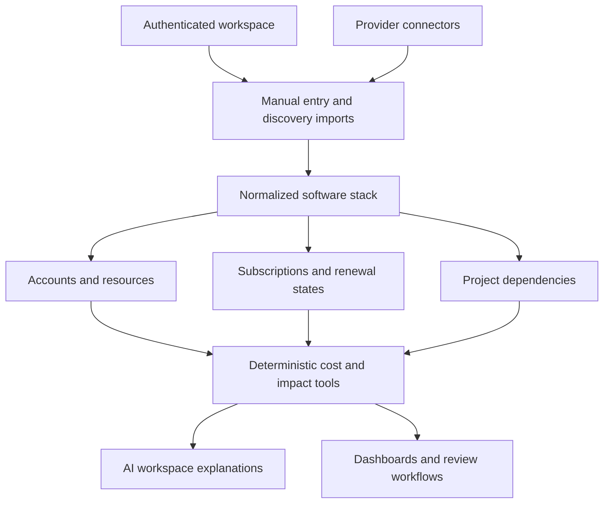
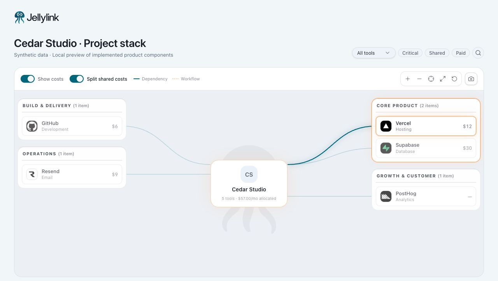

# Jellylink — AI & SaaS Stack Intelligence

Jellylink is an AI & SaaS stack intelligence platform that shows users what software they have, what they’re paying for, which accounts and projects depend on it, and where their stack overlaps.

## Product

Jellylink organizes SaaS and AI tools, accounts, subscriptions, trials, renewals, and project relationships. Its implementation combines a normalized stack model, discovery and import workflows, provider connectors, deterministic cost/dependency tools, and an AI workspace layer.

## Problem

A vendor may have several accounts, each account may contain resources, and a paid plan can support several projects. A flat subscription tracker cannot reliably explain costs, cancellation impact, or which business depends on which service.

## What I Built

I designed and built the domain model and product workflows for understanding an interconnected software stack. The code includes account-aware stack linking, authenticated workspace loading, renewal and cost calculations, connector boundaries, recommendation logic, billing infrastructure, and tests across product and security behavior.

## What This Demonstrates

Domain modeling · integration architecture · grounded AI tools · OAuth workflows · dependency analysis · cost normalization · authenticated SaaS · broad automated verification.

## Architecture

This diagram shows product and service boundaries, not infrastructure topology or database structure.

## Technical Stack

React · TypeScript · TanStack Start/Router/Query · Vite · Tailwind CSS · Supabase Auth/Postgres · Vercel AI SDK · OpenAI · Zod · Stripe · Resend · Vitest · Playwright · Vercel deployment configuration.

## Engineering Decisions

### 1. Vendor ≠ account ≠ subscription ≠ project

A vendor identifies a service; an account identifies a login or organizational identity; a subscription describes access and billing; a project describes the work that depends on those services. Keeping those concepts separate supports multiple accounts, free tools, shared subscriptions, and project-specific dependency analysis without publishing the commercial schema.

### 2. Calculate costs and dependencies deterministically

Tools calculate cost breakdowns, upcoming renewals, account impact, and project dependencies before AI explains them. Financial arithmetic and graph relationships remain inspectable application logic.

### 3. Connect discovery to existing product state

Provider-linked project discovery reconciles with the existing stack model. The architecture avoids treating imported provider records as an unrelated second inventory.

### 4. Keep provider differences behind connector boundaries

OAuth exchange, provider permission handling, and service-specific adapters accommodate different API capabilities. Connector results are subject to provider configuration and access; the UI cannot assume every vendor offers equivalent discovery.

### 5. Make verification cover product constraints

The repository tests domain calculations, stack mapping, provider behavior, authentication, billing event state, and navigation. Dedicated checks inspect client-bundle security and migration timestamp consistency.

## Production Considerations

Authenticated server middleware and workspace-scoped queries support data isolation. Server rate limiting and fail-closed scheduled-job authorization are implemented. Billing state and account lifecycle handling have dedicated tests; Resend provides the email integration boundary. Vitest and Playwright suites sit alongside type checking, linting, bundle-security checks, and migration validation. Focused calculation tests were also executed for this portfolio; the private application was not deployed or reconfigured.

## Current Implementation and Direction

The current implementation contains real connector and AI tool paths. Live discovery coverage depends on each provider’s API, permissions, and configured credentials; it is not a claim of universal subscription ingestion.

## Product Walkthrough

Jellylink connects project dependencies with financial context: understand which tools support a project, isolate shared services, and compare allocated project spend with the full tool bill. The implemented map and account-detail view keep these decisions connected.

Captured using Jellylink's original logo, wordmark, and product components with synthetic data in a local component preview. The preview header is separate from the full authenticated application shell.

[Follow the three-step walkthrough: project context → shared dependencies → cost allocation](docs/product-walkthrough.md).

## Verified Engineering Evidence

**29 focused tests across five files passed** for cost calculations, spend aggregation, spend presentation, and AI-spend intelligence. Browser checks confirmed that the Shared filter reduced the synthetic map from five tools to three, and the cost toggle changed Vercel from $12 allocated to $24 full cost. These are scoped component and calculation checks, independent of live provider discovery.

Checks were run on October 13, 2026. Test results describe the stated scope and are not customer or business outcome claims.

## Source Policy

Jellylink’s application source remains private because its product logic and commercial integrations are proprietary. This public repository contains newly written, sanitized documentation—not production code, credentials, customer records, internal prompts, detailed schemas, or sensitive infrastructure information.
