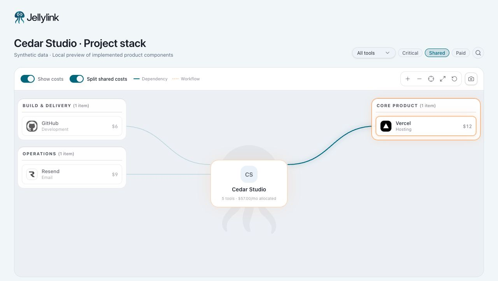
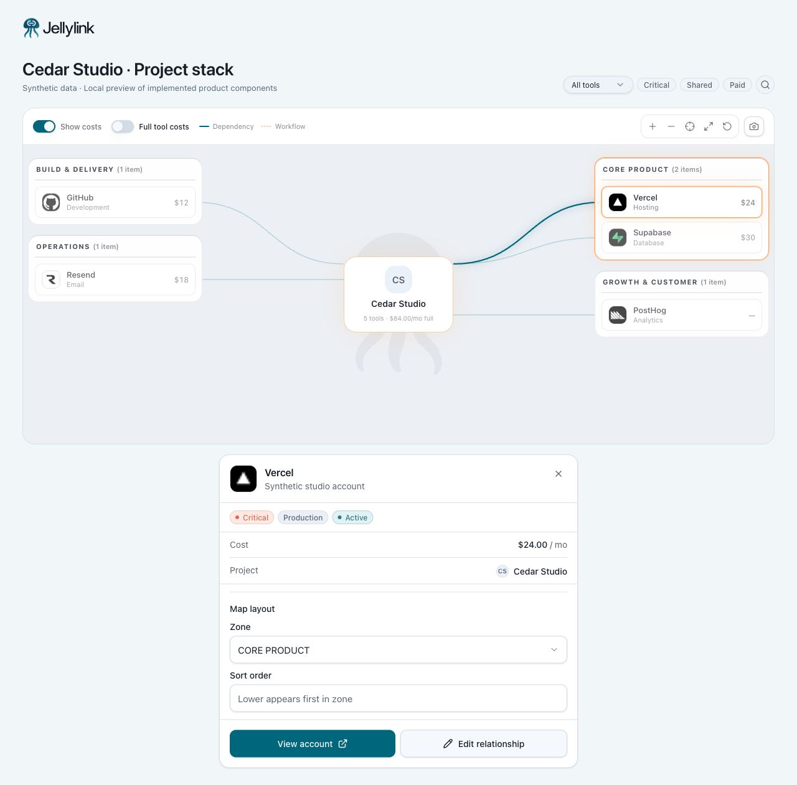

# Jellylink: understand project dependencies and shared spend

Jellylink connects the technical view of a software stack with its financial context. This walkthrough follows one question: **which tools support this project, which are shared, and what cost belongs to this project?**

The screenshots use Jellylink's original logo, wordmark, map, filters, and account-detail components. Cedar Studio, its account labels, costs, and relationships are synthetic fixtures in a local component preview.

## 1. Understand the stack in context

Cedar Studio's five tools are organized into build and delivery, core product, operations, and growth. The map places the project at the center and makes its supporting tools visible together. The synthetic dependency links connect GitHub to Vercel and Vercel to Supabase.

This gives an operator a project-level view of technical dependencies alongside cost. GitHub and Vercel are part of a delivery path; Resend and PostHog serve different operational roles. The map provides context that a flat subscription list cannot express.

## 2. Identify the shared part of the stack

Selecting **Shared** narrows the displayed map from five tools to three: GitHub, Vercel, and Resend. Each is assigned to two synthetic projects. Supabase and PostHog are dedicated to Cedar Studio and leave this filtered view.

The interaction helps isolate cross-project dependencies for review. The center still shows the complete project's five-tool, $57 allocated summary; filtering changes the visible nodes without redefining the project's total spend.

## 3. Distinguish project allocation from the full tool bill

Clear **Shared**, then switch off **Split shared costs**. The map and selected account detail show the full cost instead of the project's share:

| Synthetic tool | Allocated to Cedar Studio | Full monthly cost |
| --- | ---: | ---: |
| GitHub | $6 | $12 |
| Vercel | $12 | $24 |
| Supabase | $30 | $30 |
| Resend | $9 | $18 |
| PostHog | $0 | $0 |
| **Total** | **$57** | **$84** |

The $27 difference is an allocation distinction, not demonstrated savings. Shared tools should not be counted as a complete bill against every project. The selected Vercel panel also keeps the synthetic account, project, criticality, and subscription status available beside the map.

## Engineering demonstrated

- **Connected product context:** a project map combines tool roles, dependency relationships, and account context in one view.
- **Explicit display semantics:** filtering the map and changing the cost basis are separate decisions; visible-node scope does not silently change the project summary.
- **Testable financial logic:** a separate focused run passed 29 cost/spend tests across five files. Browser checks verified the three-tool Shared view, Vercel's $12 → $24 display change, and the $57 → $84 summary change.

## Capture scope

Captured October 14, 2026 from actual product components and original brand assets. The local preview supplies synthetic data and a preview header; it does not reproduce the complete authenticated application shell. Map interactions were exercised directly. These captures do not assert live provider ingestion, account edits, billing transactions, or database persistence. Vendor names identify the example tools; the fixture amounts are not vendor pricing quotes.
